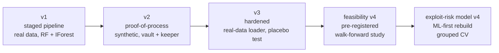

# DeFi Forensic Yield Aggregator — ML Exploit-Risk Research

An off-chain research project asking one question:

> **Can public DeFi yield / TVL data (DeFiLlama) flag pools that are about to be exploited — and can that signal drive a risk-gated yield allocator?**

The repository is the full, unedited history of five notebook iterations (`v1 → v2 → v3 → feasibility v4 → risk-model v4`). Each version fixes the weaknesses found in the previous one. **No on-chain component exists anywhere**: no wallets, RPC calls, contracts or transactions. Everything is pure Python on public HTTP data.

> **Honest headline.** Under the pre-specified decision rules, the real-data runs in `v4` report **no evidence of exploit-prediction skill**. Only a handful of hacks (≈9–12) leave an observable yield/TVL footprint, so the intervals are wide. The value of this repo is a leakage-safe, tested, reproducible *pipeline and evaluation method*, including a documented negative result.

---

## Repository layout

```
defi-forensic-yield-aggregator/
├── README.md
├── LICENSE
├── requirements.txt
├── .gitignore
└── notebooks/                        # original notebooks, unmodified
    ├── defi_forensic_yield_aggregator_v1.ipynb
    ├── defi_forensic_yield_aggregator_v2.ipynb
    ├── defi_forensic_yield_aggregator_v3.ipynb
    ├── defi_forensic_feasibility_v4.ipynb
    └── defi_exploit_risk_model_v4.ipynb
    # created when you run them (git-ignored):
    #   artifacts/   raw API cache + outputs (v2, v3, v4)
    #   data/        raw / processed / models (v1)
```

## Version lineage



| # | Notebook | Purpose | Data | Headline outcome (from saved outputs) |
|---|---|---|---|---|
| 1 | `defi_forensic_yield_aggregator_v1` | Original end-to-end prototype as 10 stages (00–09) | Real (DeFiLlama) | 17/17 project quality checks passed |
| 2 | `defi_forensic_yield_aggregator_v2` | Rebuild as a single "proof-of-process": ML engine + simulated vault/keeper | Synthetic by default | 20/20 checks passed (machinery works; not evidence of skill) |
| 3 | `defi_forensic_yield_aggregator_v3` | Review fixes, real-data loader with cache, placebo test, diagnostics | Synthetic or real (cached) | Real run: 4/12 incidents detected vs 0.27 placebo, P(≥4 by chance)=0.42 → no evidence |
| 4a | `defi_forensic_feasibility_v4` | Pre-registered feasibility study (walk-forward, pool-level labels) | Real (cached) | 1/11 detected vs 0.16 placebo → **no evidence**; 44/44 checks passed |
| 4b | `defi_exploit_risk_model_v4` | ML-first rebuild (purged grouped CV, 3 learners + ensemble) | Real (cache from 4a) | ROC-AUC 0.606 [0.124, 0.677], 9 incidents → **no evidence**; 31/31 checks passed |

---

## Procedure of each version

### v1 — `defi_forensic_yield_aggregator_v1.ipynb` (staged prototype)
One file holding ten consecutive stages. Run top to bottom.

| Stage | What it does |
|---|---|
| **00 Data acquisition** | Pulls pool list and per-pool yield history from `yields.llama.fi` and the hack feed from `api.llama.fi/hacks`. Bounded by `MAX_POOLS` (600) and `MIN_TVL_USD` (1M); responses cached to `data/raw/`; `FORCE_REFRESH` to re-pull. |
| **01 Features and approximate labels** | Rolling pool features (APY, log-TVL, 7-observation TVL return, APY delta, APY volatility). Weak labels: a hack is matched to a pool only on identical normalised names or a reviewed alias table. |
| **02 Train local models** | Forward-in-time split with a 7-day purge. Isolation Forest on normal training rows; Random Forest only if enough independent positive incidents exist. Saved to `data/models/`. |
| **03 Time-based backtest** | Evaluates held-out predictions: alerts, PR-AUC, ROC-AUC (only when labels support it). |
| **04 Forensic risk gate** | Transparent hard rules plus optional model signals on the latest observation per pool → paper BLOCK / REVIEW verdicts. |
| **05 Strategy and allocation** | Capped (pool / protocol) paper allocation from screened pools. |
| **06 Rebalance dry-run and stress** | Deterministic what-if simulation with slippage/costs and hypothetical shocks. |
| **07 Monitoring and feedback** | Freshness / missingness / drift checks; human-feedback queue (blank ≠ label). |
| **08 Pitch summary** | Assembles coverage, limitations, allocation, scenarios, figures. |
| **09 Quality checks** | 17 invariant checks; raises on failure. |

*Limitation that motivated v2:* weak labels, correlated rows, split into many notebooks (fragile paths).

### v2 — `defi_forensic_yield_aggregator_v2.ipynb` (proof-of-process)
Single notebook implementing the 10-step implementation plan with the on-chain parts replaced by tested Python.

1. **§0 Config:** all tunables in one dataclass. `USE_REAL_DATA=False`, `ALLOW_NETWORK=False` by default.
2. **§1 Data:** synthetic universe with planted, noisy exploit precursors (same schema as DeFiLlama).
3. **§2 Features and labels:** point-in-time features; forward-window labels with post-incident quarantine.
4. **§3 Forensic engine:** Isolation Forest + gradient-boosted trees, hard-rule floor, three verdict tiers; time-split with purge; incident-level held-out evaluation.
5. **§4 On-chain stand-ins:** `SimVault` (ERC-4626-style shares, roles, pause, slippage, reentrancy guard, atomic reverts) and `fork_dry_run`.
6. **§5 Allocation and keeper:** capped water-filling allocator; keeper that plans moves.
7. **§6 Walk-forward paper replay** of the test period, gated vs naive.
8. **§7 Tests:** unit, property and scenario tests, incl. a no-look-ahead truncation test (20/20 pass).
9. **§8 Monitoring:** PSI drift, decision log, human-feedback queue, retraining loop; dashboard.
10. **§9** How to switch to real data.

### v3 — `defi_forensic_yield_aggregator_v3.ipynb` (hardened)
Same skeleton as v2, with review fixes:

- Real-data loader with cache-first behaviour, request caps and a mock-server rehearsal in the tests (`ALLOW_NETWORK` off ⇒ cache only, clear error on a miss).
- Data cleaning step (`clean_history`) and an audit of the universe.
- **Placebo test:** incident detection compared with the same project's ordinary windows.
- Fuzzy-match review queue for hack-to-project names (aliases added only manually).
- Cost-safe procedure and honest-limits section (survivorship, TVL selection, label noise).
- Final **diagnostic cell**: rule vs model alert sources, single-feature AUCs with sign-flip detection, incident table.

*Result on real data:* 4/12 incidents detected vs 0.27 placebo → no evidence of skill.

### Feasibility v4 — `defi_forensic_feasibility_v4.ipynb` (pre-registered study)
Reframes the project as a feasibility study with the design frozen up front.

1. **§1 Config:** cache-first, network off by default.
2. **§2 Data layer:** loader, cache, cleaning, mock-server rehearsal.
3. **§3 Features:** point-in-time; stable-universe APY percentile replaces the shifting-universe rank; `log_tvl` excluded by default.
4. **§4 Incidents and labels:** category filter (only hacks that can leave a yield/TVL trace), pool-level labels, quarantine of unaffected pools, walk-forward folds.
5. **§5 Models:** rules, Isolation Forest, supervised classifier with nested time-ordered model selection.
6. **§6–7 Evaluation:** incident-level detection vs same-project placebo, Holm-corrected; row-level metrics with project-cluster bootstrap CIs.
7. **§8 Ablations and sensitivity analyses.**
8. **§9–10 Vault, allocator, keeper, paper replay** on out-of-fold scores (secondary evidence).
9. **§11 Monitoring:** PSI, decision log, human-feedback queue, run manifest.
10. **§12–13 Figures and test suite** (44/44 pass).
11. **§14 What the notebook can and cannot support.**

*Result:* all folds stayed anomaly-only (3–4 incidents, 5 needed) → 1/11 detected vs 0.16 placebo → no evidence.

### Exploit-risk model v4 — `defi_exploit_risk_model_v4.ipynb` (ML-first rebuild)
Fixes why the classifier never trained in the feasibility run. Reuses `artifacts/raw` from that notebook (**run the feasibility notebook first**, or set `ALLOW_NETWORK=True` once).

1. **Primary validation:** purged, project-grouped K-fold, repeated; walk-forward kept only as a stress test.
2. **Models:** regularised logistic regression, shallow gradient boosting, extra-trees, and an ensemble; Isolation Forest for comparison.
3. **Market-relative features** (TVL change vs the day's market, cross-sectional percentiles).
4. **Honest baseline:** best single feature chosen inside each training fold.
5. **Two separate questions:** risk profile (row-level AUC / PR-AUC) and timing (pre-hack window vs the project's ordinary weeks).
6. **Computed verdict** from a pre-specified rule (A risk profile, B timing).
7. **Interpretation and robustness:** coefficients / importances, ablations, walk-forward, label-gap check.
8. **Final model and watchlist**, figures, and 31 tests with positive and negative synthetic controls.

*Result:* ensemble ROC-AUC 0.606 (CI [0.124, 0.677]), PR-AUC 0.0021 vs base 0.0015, 9 evaluable incidents → no evidence of skill under the pre-specified rule.

---

## How to run

```bash
git clone https://github.com/<your-username>/defi-forensic-yield-aggregator.git
cd defi-forensic-yield-aggregator
python -m venv .venv
# Windows: .venv\Scripts\activate      macOS/Linux: source .venv/bin/activate
pip install -r requirements.txt
```

Open a notebook in VS Code (or `jupyter lab`), select the `.venv` kernel and **Restart & Run All**. All notebooks write relative to their own folder, so keep them together in `notebooks/`.

Recommended order: `v1 → v2 → v3 → feasibility_v4 → exploit_risk_model_v4`.

| Notebook | Network? | Notes |
|---|---|---|
| v1 | Yes (stage 00) | Writes `data/`. Set `OFFLINE_MODE=True` after the first pull. |
| v2 | No by default | Synthetic data. Flip `USE_REAL_DATA` **and** `ALLOW_NETWORK` to use real data. |
| v3 | No by default | Real-data procedure in §9: fetch once, then set `ALLOW_NETWORK=False`. |
| feasibility v4 | Once | Set `ALLOW_NETWORK=True` once to fill `artifacts/raw`, then back to `False`. |
| risk model v4 | No | Uses the feasibility cache. Both v4 notebooks write `artifacts/v4/`; copy outputs out between runs if you need both. |

## Known limitations (all versions)

- **Few observable incidents** (≈9–12): confidence intervals are wide whatever the model does.
- **Survivorship:** the pool catalogue lists currently-listed pools; mitigated, not removed, by force-including hacked projects.
- **Label noise:** hack dates, classifications and name matching are imperfect; reported APY is not realised yield.
- **Regime change** between 2021 and 2026.
- Simulator parameters (`EXPLOIT_LOSS_FRACTION`, stress shocks, DEX depth) are assumptions, not measurements.
- Nothing here is investment advice or a deployable security product.

## Data sources

[DeFiLlama](https://defillama.com) public APIs: `yields.llama.fi` (pools, charts) and `api.llama.fi/hacks`. Respect their terms and rate limits; the notebooks cache responses and cap requests by default.

## License

MIT — see [LICENSE](LICENSE).
